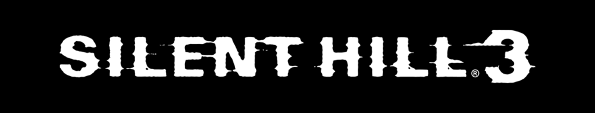

<p align="center">
  
</p>

<h3 align="center">sh3vita: Silent Hill 3 for PlayStation Vita</h3>

<p align="center">
  An experimental port of the 2003 PC version of Silent Hill 3, built by static recompilation.<br>
  Version 0.1.0 — early test. Bring your own copy of the game.
</p>

<p align="center">
  
  
  
</p>

sh3vita runs Silent Hill 3 from the PC version's own data on a hacked PS Vita. A recompiler translates the game's
`sh3.exe` (x86) to C, and a Win32 / Direct3D 8 / DirectInput / DirectSound compatibility layer runs it over
[vitaGL](https://github.com/Rinnegatamante/vitaGL). It shares its runtime with [sh4vita](https://github.com/vallfrr/sh4vita),
the same author's Silent Hill 4 port, and was inspired by [sh3-nx](https://github.com/cutarev/sh3-nx) (Switch) and
[AngeloGalav/sh3-vita](https://github.com/AngeloGalav/sh3-vita), another Silent Hill 3 port for the Vita.

**sh3vita contains no game data.** You need your own copy of the PC game. The VPK holds the port; the `sh3prep` tool
prepares your own game files on your computer.

> [!WARNING]
> This is an early test release. See [docs/KNOWN-ISSUES.md](docs/KNOWN-ISSUES.md) before trying it: the frame rate
> depends a lot on the area (about 17 to 38 fps), and the flashlight's glow effect is still missing.

## What you need

- A hacked PS Vita (HENkaku/Enso) with about 6 GB free on `ux0:`.
- `ur0:data/libshacccg.suprx` on the Vita (install it with [ShaRKF00D](https://github.com/Rinnegatamante/ShaRKF00D)): the port compiles its shaders with it.
- Silent Hill 3 for PC, with the exact executable below. Other versions do not work.
  `sh3.exe`: 3,338,240 bytes, SHA-256 `a51f956bd5be21fd704c4d19cf0674a175d002081da43b1d377be83226c36e5e`.
- `sh3vita.vpk` and the `sh3prep` download for your computer, from the Releases page.

## Install

1. **Prepare the files on your computer.** Run `sh3prep`, select the game folder (the one that contains `sh3.exe` and
   `data/`), choose a separate output folder and press *Prepare the files*. It checks the executable, copies your files,
   decrypts the seven movies and converts them to MP4 (ffmpeg is built into `sh3prep`, nothing else to install). From a terminal: `sh3prep <game folder> <output folder>`.
2. **Install `sh3vita.vpk`** on the Vita with VitaShell.
3. **Copy the generated `sh3` folder** to `ux0:data/` on the Vita (USB is much faster than FTP). You should get:

```text
ux0:data/sh3/
  sh3.exe
  data/
  movie/        (op.mpg, op.mp4, ...)
  sh3vita.json
```

4. Start Silent Hill 3 from the LiveArea. Saves go to `ux0:data/sh3/savedata/`, logs and shader caches are written next to them.

The first launch compiles shaders on the console, so the first minutes stutter more than later runs.

## Updating

Install the new VPK over the old one with VitaShell. Keep `ux0:data/sh3/`, including your saves.

## Controls

The layout is fixed for now; you can review it in-game with Options → View controls.

| Input | In game | In menus |
|---|---|---|
| Left stick | Move / turn (Silent Hill 3's own 3D controls) | Move the cursor |
| Right stick | Look around (search view) | |
| D-pad ↑ / ↓ | Flashlight / zoom | Move the cursor |
| D-pad ← / → | Side-step | Move the cursor |
| ✕ Cross | Action / examine | Confirm |
| ○ Circle, Start | Pause | Back |
| □ Square | Run | |
| △ Triangle | Inventory | |
| Select | Map | |
| L | Search view | Previous Options page |
| R | Ready the weapon | Next Options page |

## Status

| Area | State |
|---|---|
| Boot, menus, options (including gamma), saving and loading | Works |
| Intro movie and the six other movies | 30 fps with the converted MP4 files, original audio |
| New game, the amusement park and the first areas | Played |
| Inventory | Works with the pad |
| Whole game | Only partly tested: please report problems |
| Flashlight glow, lens flares | Not rendered (see known issues) |
| Frame rate | Between about 17 and 38 fps depending on the area; the game logic steps at 30 or 20 Hz |

## Known limitations

See [docs/KNOWN-ISSUES.md](docs/KNOWN-ISSUES.md). In short: some areas (church, hospital back rooms, the amusement
park, sewers) run below 30 fps; the flashlight glow is missing; memory is tight in very long sessions.

## Build from source

You do not need this to play: the Releases page has the VPK and the preparers. This is for people who want to
rebuild the port. **No game file is ever in this repository.** The C code generated from your own `sh3.exe`
(`port/gen/`, tens of megabytes) and the analysis output (`re/out/`) are produced on your machine and are never committed.

1. Put your `sh3.exe` (the supported hash above) at `game/sh3.exe`.
2. List its functions with Ghidra 12 (JDK 21):
   `analyzeHeadless <project-dir> sh3 -import game/sh3.exe -scriptPath re/ghidra -postScript ExportFunctions.java re/out/functions.json -deleteProject`
3. Generate the C code: `python recomp/x86rec.py` (needs Python 3 and Capstone; a few minutes, writes `port/gen/`).
4. Build vitaGL at commit `2bdbe895ddc6a7e410a9ea55a8f53d8173c61ad8`, apply `port/patches/vitagl-sh3.patch`, and build it with
   `make -B NO_DEBUG=1 STORE_DEPTH_STENCIL=1`. See [docs/WORKFLOW.md](docs/WORKFLOW.md).
5. Build the VPK from Linux or WSL with VitaSDK: `bash port/build.sh`. The result is `build/sh3vita.vpk`.
6. Build the preparer: `cd tools/sh3prep && cargo test --release && cargo build --release`.

More in [docs/WORKFLOW.md](docs/WORKFLOW.md) and [docs/PREPARED-DATA.md](docs/PREPARED-DATA.md).

## License

The original code in this repository (the recompiler, the runtime, the Vita layer and the `sh3prep` preparer) is
released under the GNU General Public License v3.0; see [LICENSE](LICENSE). Third-party components keep their own
licenses: see [THIRD_PARTY_NOTICES.md](THIRD_PARTY_NOTICES.md) and `LICENSES/`. The GPL covers this project's code
only. It does not cover Silent Hill 3.

## Legal

Silent Hill 3 belongs to Konami. This project is not affiliated with, endorsed by or sponsored by Konami or Sony.

- No game file is included in this repository, in the VPK or in `sh3prep`. The port only works with your own legitimate
  copy of the game, which `sh3prep` checks by hash before preparing anything.
- The C code generated from the game executable is created on your own machine and is never distributed.
- Do not ask for game files, ROMs, dumps or pirated copies in issues or discussions: they will be removed.
- You need a Vita with custom firmware. Install and use this port at your own risk.

## Credits

- Port, recompiler, runtime and tools: vallfrr.
- AI tools assisted the reverse engineering and the coding. Design decisions and validation on real hardware were done by hand.
- The Vita ecosystem: VitaSDK, vitaGL, vitaShaRK, SceShaccCgExt and math-neon (Rinnegatamante and contributors), taiHEN, HENkaku, VitaShell, ShaRKF00D.
- [sh4vita](https://github.com/vallfrr/sh4vita) (the runtime this port builds on), [sh3-nx](https://github.com/cutarev/sh3-nx) and
  [AngeloGalav/sh3-vita](https://github.com/AngeloGalav/sh3-vita): reference ports of Silent Hill 3 and 4; the movie container
  decoding was cross-checked against AngeloGalav's published description.
- Libraries: SDL2 (zlib license), pl_mpeg by Dominic Szablewski (MIT), TLSF by Matthew Conte (BSD 3-clause).
- Reverse engineering tools: Ghidra, Capstone.
- LiveArea artwork: community images from SteamGridDB (icon by FrostWolf, hero by Maxine, logo by kaito); Silent Hill and its logo belong to Konami.
- Controller screen artwork: Vita outline by Tokyoship (Wikimedia Commons, CC BY 3.0), recolored; button prompts from Kenney Input Prompts (CC0).
